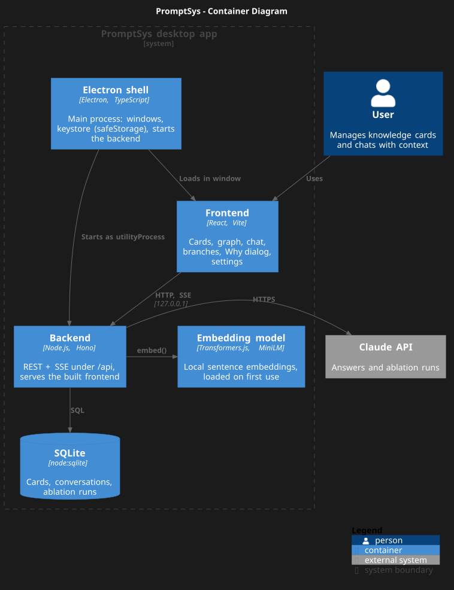
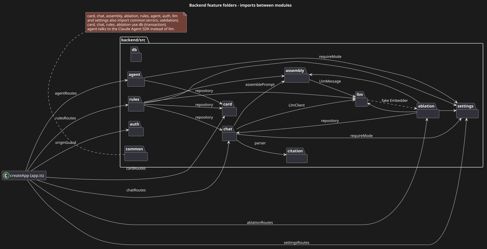
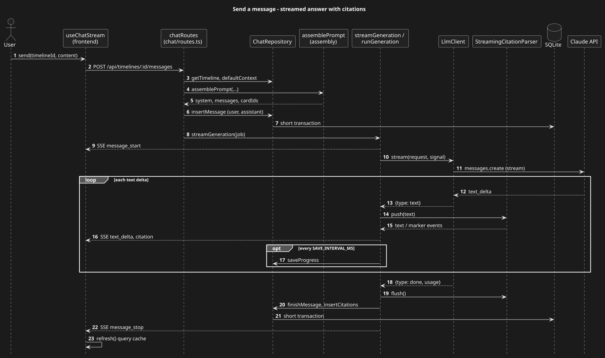
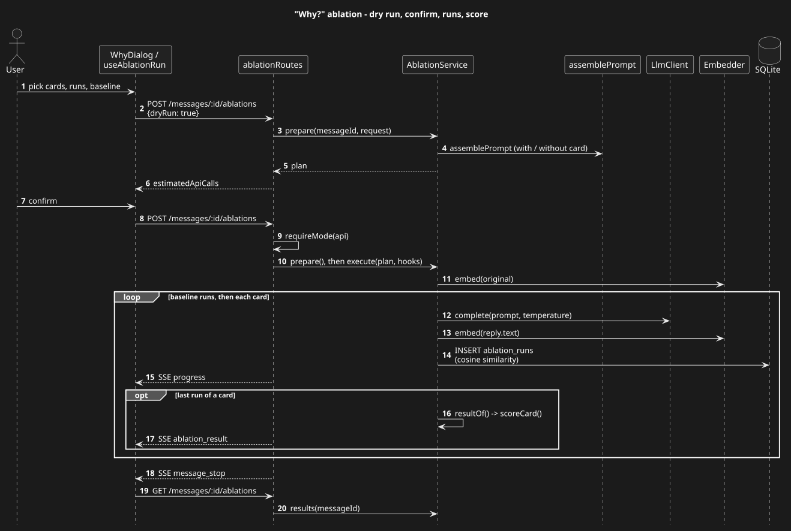
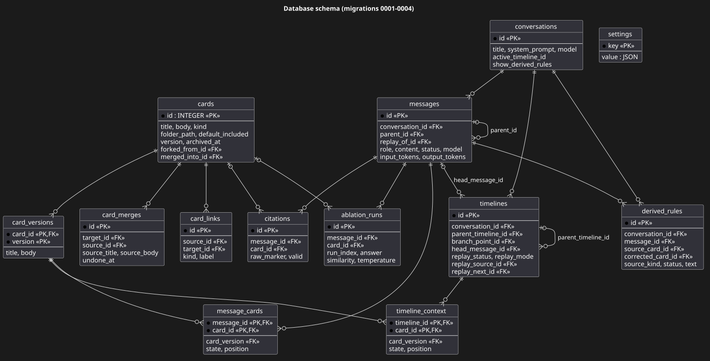
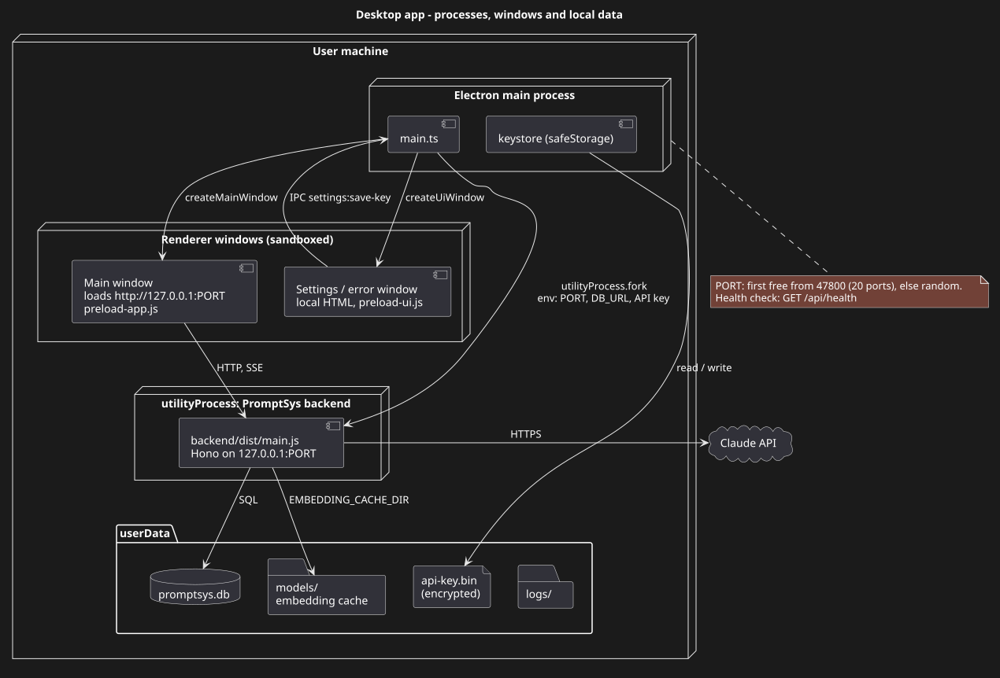

# PromptSys

**See, negotiate and verify the context behind every AI answer.**

> **Status:** Working prototype (semester project). API mode with chat, cards, ablation, derived rules, replays and branch view; Agent mode for coding sessions; desktop app for macOS, Windows and Linux.

---

## The problem

When you talk to an AI assistant, a lot more goes into an answer than your message: memory entries, uploaded files, search results, earlier turns, system instructions. Neither side can talk about it:

- **You** don't know which of these actually shaped the answer.
- **You** can't say "leave that out" before the answer is generated.
- **The model** can only *claim* what it used; nobody checks whether that claim is true.

Human and AI never agree on a shared basis for the conversation.

## The idea

PromptSys is a local chat application, later shipped as a desktop app, that sits **in front of** the model instead of inside it. Because it assembles the context itself, it knows exactly what was sent and can show every piece as a **context card**.

```
┌────────────┐      ┌─────────────────────────────┐      ┌───────────┐
│  UI        │ ───▶ │  PromptSys                  │ ───▶ │  LLM API  │
│  (cards)   │ ◀─── │  registry · assembly · eval │ ◀─── │  (Claude) │
└────────────┘      └─────────────────────────────┘      └───────────┘
```

### Three stages

1. **Before sending — negotiate**
   You see the cards that are about to be sent and can pin, remove or add them.

2. **In the answer — cite**
   Every card gets an ID (`c1`, `c2`, …). The model marks claims with `[c3]`, and the answer shows which cards were used and which were ignored.

3. **After the answer — verify**
   Click *"Why?"* on a card and PromptSys regenerates the answer **without** it, then measures how much the answer changes. That measures what the card actually did, instead of relying on what the model says it did.

### Beyond single answers

- **Derived rules:** PromptSys shows the rules and assumptions the model derived from the context, e.g. *"`required` means the field must be present"*, together with their source (a card or the model's prior knowledge). You can confirm or correct them, so a misunderstanding is caught before it spreads through the whole conversation.
- **Alternate timelines:** Pick an earlier message, change the context (disable, edit or add a card, correct a rule) and replay the following prompts in order. All timelines of a conversation are shown as branches, similar to a Git graph.

## Attribution methods

| Method | How it works | Requires | Reliability |
|---|---|---|---|
| Self-citation | Model tags claims with card IDs | Any API | Low: it's the model's own report |
| Ablation (similarity) | Regenerate without card X, compare via embeddings | Any API + embeddings | Medium: actually tests causation, but noisy |
| Ablation (likelihood) | Score how likely the original answer remains without card X | Local / open-weights model | High |

Version 1 uses **self-citation + similarity ablation**, both of which work with a hosted API. Likelihood-based attribution (see ContextCite, AttriBoT) is a later option via a local model.

## Features

### MVP
- [x] Chat via the Claude API
- [x] Context registry: notes and files (text, Markdown, code, PDF, DOCX) as cards with stable IDs
- [x] Prompt assembly with ID-tagged context blocks
- [x] Parsing of citation markers (incl. during streaming)
- [x] Card view below each answer (used / unused)
- [x] Graph view: cards as nodes, links as lines; link and merge cards there

### Negotiation
- [x] Pre-send card review: pin, exclude, add
- [x] Own memory store, managed as cards
- [x] Regenerate without selected cards

### Verification
- [x] "Why?" button: ablation per card
- [x] Embedding-based change score per card
- [x] Multiple runs to reduce noise

### Understanding
- [x] Derived rules: show the rules and assumptions the model derived, with their source (card or prior knowledge)
- [x] Confirm or correct a derived rule; a corrected rule becomes a card

### Alternate timelines
- [x] Pick an earlier message as branch point, change the context and replay the following prompts
- [x] Step-by-step replay (recommended) or automatic replay with an explicit warning
- [x] Branch off during a replay and continue freely
- [x] Show the expected number of API calls before a replay
- [x] Branch view of all timelines, similar to a Git graph

### Agent mode
A second mode for coding sessions on a local project folder. It runs your installed Claude Code through the Claude Agent SDK and shares the card library with API mode.
- [x] Sessions with a live timeline, tool approvals, permission modes (ask, accept edits, plan, auto) and a stop button
- [x] Status line: model, folder, git branch, context usage, tokens; plan limits once for all sessions
- [x] Changes panel (uncommitted diff), subagents panel, slash commands and skills of your setup, highlighted code blocks
- [x] The agent proposes glossary cards (terms and resources, sorted into folders); you confirm, correct or reject them, and only accepted cards join the library
- [x] Confirmed cards bind later turns; reference any card in a message with `@` or by dragging it in

### Later
- [ ] Local model (e.g. via Ollama) for likelihood attribution
- [ ] Web search results as cards

## Download

Installers for macOS, Windows and Linux are attached to each [release](https://github.com/enessosa/PromptSys/releases) (unsigned: macOS and Windows warn on first start).

- **API mode** needs your own Claude API key (entered in the app, stored in the system keychain).
- **Agent mode** runs coding sessions on your installed Claude Code. PromptSys does not ship it: [install Claude Code](https://code.claude.com/docs/en/setup) and run `claude` once to sign in. Agent mode runs your own installed Claude Code with your own login and plan; PromptSys never sees the login, and your use is subject to Anthropic's terms.

## Tech stack

| Layer | Technology |
|---|---|
| Backend | TypeScript, Node.js, Hono |
| Frontend | React, TypeScript, Vite, Primer React |
| Database | SQLite |
| LLM | Anthropic Claude API; Claude Agent SDK (Agent mode) |
| Deployment | Desktop app with Electron (macOS, Windows, Linux), or backend + browser |

## Architecture diagrams

PlantUML sources and more details in [docs/diagrams](docs/diagrams/README.md).

### Overview


### Backend modules


### Send a message


### "Why?" ablation


### Database schema


### Desktop app


## Open questions

- **Granularity:** What is one card: a whole document, a section, a sentence?
- **Noise:** How many regenerations are needed before an ablation result is trustworthy?
- **Model knowledge:** How do we show the difference between "the card was irrelevant" and "the model already knew this anyway"?

Cost is not a reason to leave a feature out: before an ablation or replay, PromptSys shows the expected number of API calls and you decide.

## Related work

- [ContextCite](https://github.com/MadryLab/context-cite) — context attribution via ablation and a linear surrogate model (NeurIPS 2024)
- [AttriBoT](https://github.com/r-three/AttriBoT) — efficient leave-one-out context attribution (ICLR 2025)
- [larpie](https://pypi.org/project/larpie/) — developer middleware for attribution of LLM calls

PromptSys does not try to advance this research. It aims to make it usable as an end-user interface.

## License

[MIT](LICENSE). Third-party components keep their own licenses; the Claude Agent SDK is subject to Anthropic's terms. Claude and Claude Code are trademarks of Anthropic; this project is not affiliated with or endorsed by Anthropic.
