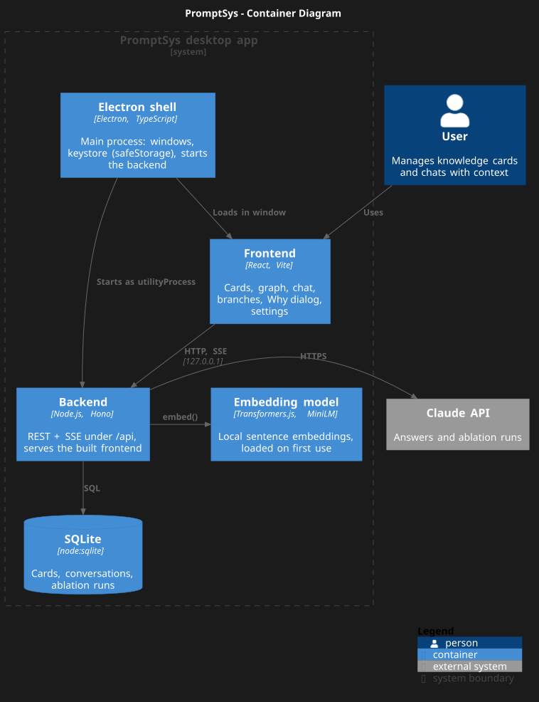
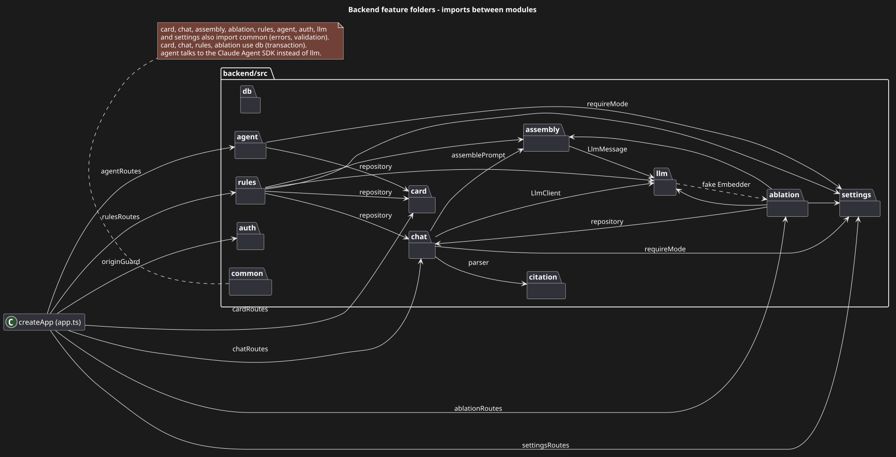
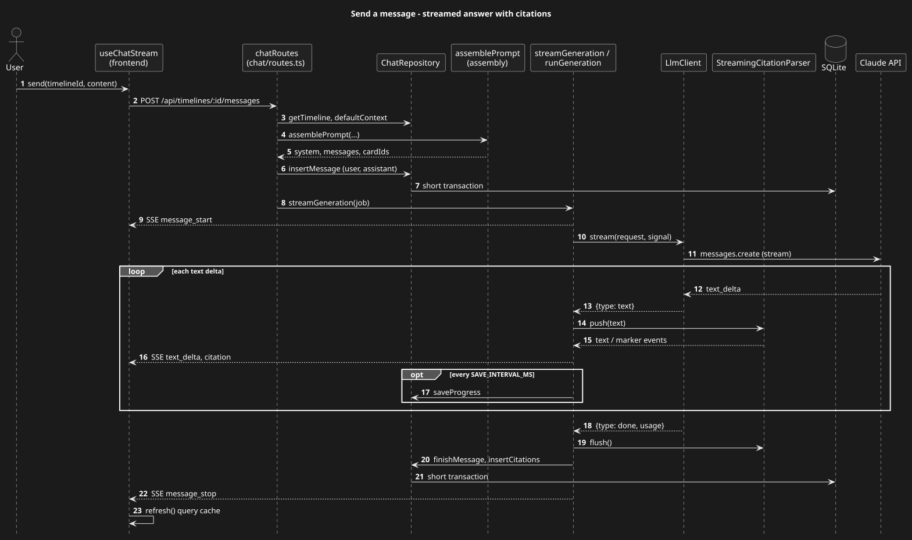
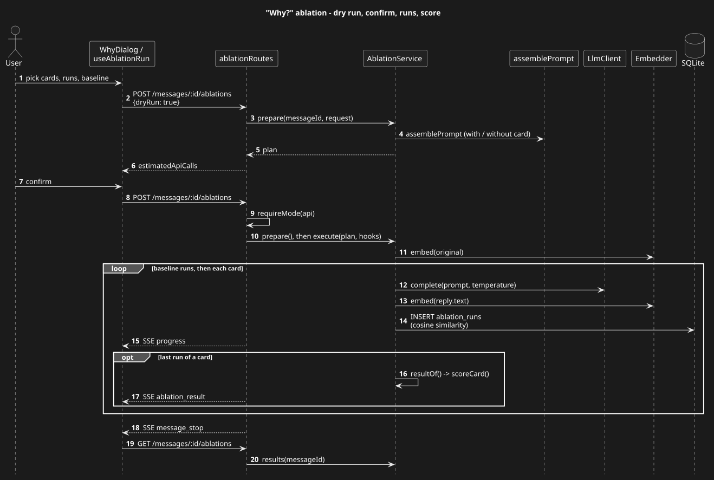
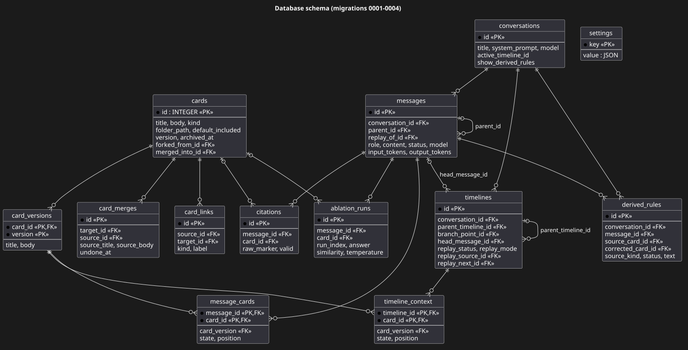
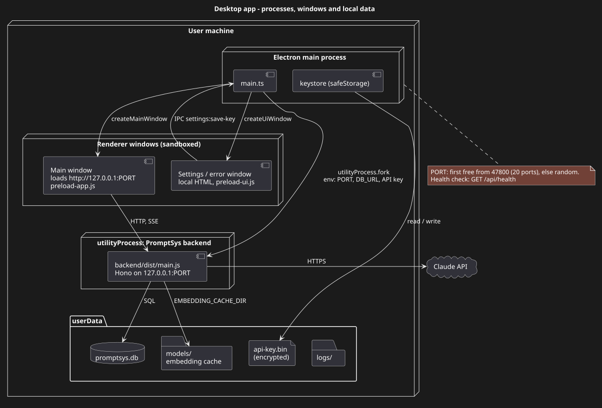

# PromptSys diagrams

PlantUML sources (`.puml`) with SVG renderings (dark mode, rendered with `plantuml -tsvg --dark-mode -failfast2`).

## PromptSys - Container Diagram
C4 container view: frontend, backend, SQLite, local embedding model, Claude API and the Electron shell.

Source: [architecture-c4.puml](architecture-c4.puml)

## Backend feature folders - imports between modules
Dependencies between the backend feature folders, taken from the real imports.

Source: [backend-package.puml](backend-package.puml)

## Send a message - streamed answer with citations
`POST /api/timelines/:id/messages` through prompt assembly, LLM stream, citation parser and SSE events to persistence.

Source: [chat-sequence.puml](chat-sequence.puml)

## "Why?" ablation - dry run, confirm, runs, score
Dry-run estimate, confirmation, baseline and card runs with local embeddings, and the scoring.

Source: [ablation-sequence.puml](ablation-sequence.puml)

## Database schema (migrations 0001-0004)
All 13 tables with their foreign keys.

Source: [database-er.puml](database-er.puml)

## Desktop app - processes, windows and local data
Electron main process, backend utility process, renderer windows and the files in userData.

Source: [desktop-deployment.puml](desktop-deployment.puml)
